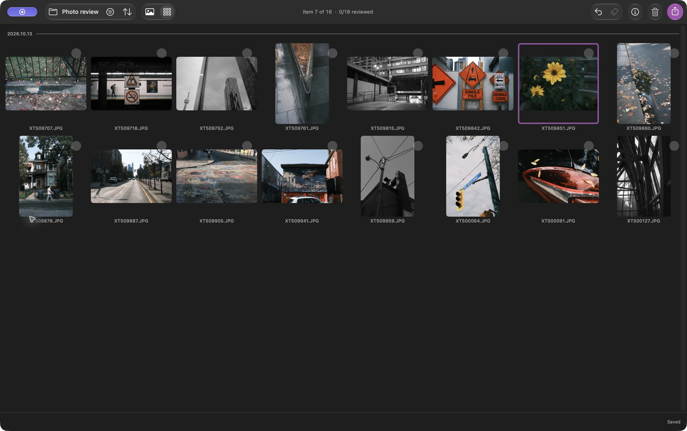

أحيانًا أريد اختيار أفضل الصور من نزهة ووضعها في مجلد. لا حاجة إلى جلسة تحرير، أو معالجة RAW، أو استيراد إلى مكتبة صور

في Louppe، يمكنك فتح مجلد من صور JPEG، ووضع علامة على الصور التي تريدها، ونسخ تلك الملفات إلى مجلد منفصل. تحتفظ صور JPEG بمظهرها الحالي؛ فالنسخ لا يعيد ترميزها

Louppe تطبيق مجاني ومفتوح المصدر أُطوّره لعرض الصور وفرزها، ويعمل على أجهزة Mac المزودة بشرائح Apple silicon بنظام macOS 14 أو أحدث

## ابدأ بمجلد من صور JPEG

انسخ صور جلسة التصوير من بطاقة الكاميرا إلى مجلد على جهاز Mac أو قرص خارجي، واحتفظ بنسخة احتياطية في مكان منفصل. افتح ذلك المجلد في Louppe

يبدأ هذا الدليل بملفات `.jpg` أو `.jpeg` عادية في Finder. للصور الموجودة في Apple Photos، اختر بدلًا من ذلك **ملف ← فتح Apple Photos… (`File → Open Apple Photos…`)** وراجع المكتبة في مكانها. اترك الملفات الداخلية للمكتبة دون تغيير

*مجلد يحتوي على JPEG فقط في الشبكة، التُقط في Louppe 1.10. يحدّد الإطار البنفسجي الصورة الحالية؛ ولا يضع عليها علامة للاحتفاظ بها*

المقصود هنا بـ «فرز الصور» هو اختيار الصور التي ستحتفظ بها. أما تغيير ترتيبها حسب اسم الملف أو التاريخ فهو خيار مستقل في **ترتيب (Sort)**

## اختر الصور التي ستحتفظ بها باستخدام نعم ولا

افتح صورة في المعرض وراجع صور الجلسة لقطةً تلو الأخرى. باستخدام الاختصارات الافتراضية، اضغط **`F`** لاختيار «نعم» و**`D`** لاختيار «لا». استخدم مفاتيح الأسهم للعودة إلى لقطة

اترك الصور التي تتردد بشأنها دون قرار، وعد إليها في جولة ثانية. النجوم والتسميات اللونية اختيارية؛ يمكنك إنهاء جلسة تصوير كاملة باستخدام نعم ولا فقط

**وضع علامة «لا» لا ينقل الملف إلى سلة المهملات أبدًا**. إنه يسجّل قرارًا. **تنظيف (Clean Up)** أمر مستقل ينقل الملفات إلى سلة مهملات macOS

يحفظ Louppe القرارات في `.louppe_session.json` داخل المجلد المفتوح. انتظر تأكيد الحفظ في مؤشر الحالة قبل فصل القرص، واحتفظ بهذا الملف إذا أردت استئناف هذه المراجعة

<!-- try-louppe -->

## تحقّق من قائمة الصور المختارة قبل النسخ

صفِّ الصور لإظهار «نعم»، وراجع الصور المختارة في الشبكة. تحقّق مما إذا كنت قد احتفظت بعدة لقطات شبه متطابقة، أو أغفلت صورة ما زلت تريدها

عُد إلى المعرض لإلقاء نظرة أقرب. يتيح **`S`** تفعيل التكبير الحقيقي بنسبة `100%` أو إيقافه باستخدام المفاتيح الافتراضية، مما يساعدك على فحص التركيز. قد تختلف الاختصارات المخصّصة

## انسخ صور JPEG المختارة إلى مجلد جديد

افتح **تصدير (Export)** واختر **نسخ (Copy)**. تحقّق من النطاق وعدد الملفات المطابقة: عند وجود تحديد نشط، يبدأ التصدير بخيار **جميع المحددة (All selected)**؛ ودون تحديد، يبدأ بخيار **المقبولة (نعم) — Keepers (Yes)** ضمن نتائج التصفية. اختر نطاق الصور المقبولة عمدًا إذا كان هذا ما تريده

اختر وجهة جديدة، مثل `October walk keepers`، وانتظر اكتمال النسخ، ثم افتح الوجهة في Finder. تحقّق من ملفاتها وافتح بعض صور JPEG المنسوخة قبل مشاركتها

يحافظ النسخ على الملفات، بما في ذلك دقّتها والبيانات الوصفية المضمّنة فيها. لا يغيّر أبعادها ولا يزيل معلومات الموقع. إذا احتجت إلى ملفات أصغر أو إلى إزالة البيانات الوصفية، فأعدّ نسخًا للمشاركة بأداة توفّر هذه الخيارات

يبقى المجلد المصدر متاحًا لجولة أخرى. تغيّر أوامر **نقل (Move)**، و**إعادة تسمية (Rename)**، و**تنظيم المجلد المصدر (Organize)**، و**تنظيف (Clean Up)** مواقع الملفات أو أسماءها، كلٌّ بأمر مستقل؛ ولا تحتاج إلى أي منها لهذه الطريقة

## أكمل العمل دون محرّر RAW

لديك الآن مجلد عادي من صور JPEG المختارة. افتحه في عارض آخر، أو أرسل ملفات محددة، أو احتفظ به بوصفه قائمتك المختارة. اختيار الملفات لا يغيّر تعريضها أو ألوانها

إذا كنت تصوّر بصيغة RAW أيضًا، فاستخدم [دليل إقران RAW + JPEG](/blog/cull-raw-jpeg-pairs-mac/). وإذا كانت الخطوة التالية هي التحرير، فاتّبع [طريقة العمل قبل Lightroom](/blog/cull-photos-mac-before-lightroom/)
