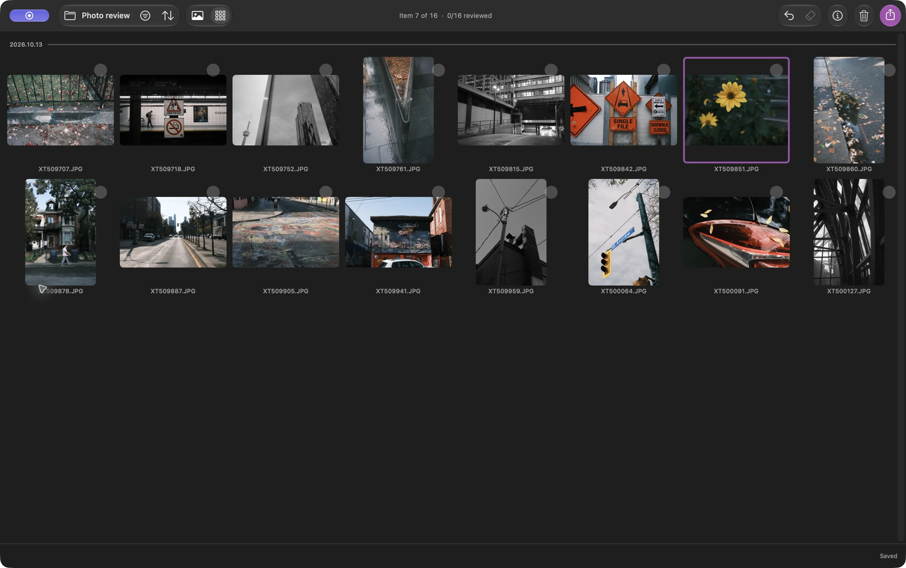

A veces quiero elegir las mejores fotos de un paseo y ponerlas en una carpeta. No necesito editar, procesar archivos RAW, ni importar fotos a una fototeca

En Louppe puedes abrir una carpeta de JPEG, marcar las fotos que quieras, y copiar esos archivos a otra carpeta. Los JPEG conservan su aspecto; copiarlos no los vuelve a codificar

Louppe es mi visor y organizador de fotos gratuito y de código abierto para Mac con Apple silicon y macOS 14 o posterior

## Empieza con una carpeta de fotos JPEG

Copia la sesión de la tarjeta de la cámara a una carpeta de tu Mac o de un disco externo y guarda una copia de seguridad aparte. Abre esa carpeta en Louppe

Esta guía parte de archivos `.jpg` o `.jpeg` normales en Finder. Para las fotos de Apple Photos, elige **Archivo → Abrir Apple Photos…** y revisa la fototeca donde está. No manipules los archivos internos de la fototeca

*Una carpeta que solo contiene JPEG en Cuadrícula, capturada en Louppe 1.10. El contorno morado identifica la foto actual; no indica que esté marcada para conservar*

Aquí, «seleccionar fotos» significa elegir qué imágenes conservar. Cambiar su orden por nombre de archivo o fecha es una opción aparte en Ordenar

## Elige qué fotos conservar con Sí y No

Abre una foto en Galería y revisa la sesión toma a toma. Con los atajos predeterminados, pulsa **F** para Sí y **D** para No. Usa las teclas de flecha para volver a una toma

Deja sin decidir las fotos que te generen dudas y vuelve a ellas en una segunda pasada. Las estrellas y las etiquetas de color son opcionales; puedes terminar una sesión completa usando solo Sí y No

**Marcar No nunca envía un archivo a la Papelera**. Registra una decisión. Limpiar es un comando aparte que mueve archivos a la Papelera de macOS

Louppe guarda las decisiones en `.louppe_session.json` dentro de la carpeta abierta. Espera a que el indicador de guardado confirme que ha terminado antes de desconectar un disco y conserva ese archivo si quieres retomar esta revisión

<!-- try-louppe -->

## Comprueba la selección antes de copiarla

Filtra por Sí y revisa las fotos elegidas en Cuadrícula. Comprueba si has conservado varias tomas casi idénticas o si te has dejado alguna foto que aún quieras conservar

Vuelve a Galería para mirarlas de cerca. Con las teclas predeterminadas, **S** activa o desactiva el zoom real al 100%, que ayuda a comprobar el enfoque. Los atajos personalizados pueden ser distintos

## Copia los JPEG elegidos a una carpeta nueva

Abre Exportar y elige **Copiar**. Comprueba el alcance y el número de coincidencias: con una selección activa, Exportar empieza con **Todos seleccionados**; de lo contrario, empieza con **Aceptadas (Sí)** del filtro actual. Elige expresamente ese alcance si lo que quieres son las fotos marcadas Sí

Elige un destino nuevo, como `October walk keepers`, espera a que termine la copia, y abre el destino en Finder. Comprueba los archivos y abre algunos de los JPEG copiados antes de compartirlos

Copiar conserva los archivos, con su resolución y sus metadatos incrustados. No redimensiona las fotos ni elimina la información de ubicación. Si necesitas archivos más pequeños o sin metadatos, prepara copias para compartir en una herramienta que ofrezca esas opciones

La carpeta de origen sigue disponible para otra pasada. Trasladar, Cambiar nombre, Organizar, y Limpiar cambian las ubicaciones o los nombres de los archivos mediante comandos separados; no necesitas ninguno para este flujo de trabajo

## Termina sin un editor RAW

Ahora tienes una carpeta normal con los JPEG elegidos. Ábrela en otro visor, envía los archivos que selecciones, o consérvala como tu selección. Seleccionar archivos no cambia su exposición ni su color

Si también disparas en RAW, consulta la [guía para emparejar RAW + JPEG](/blog/cull-raw-jpeg-pairs-mac/). Si el siguiente paso es editar, sigue el [flujo de trabajo previo a Lightroom](/blog/cull-photos-mac-before-lightroom/)
