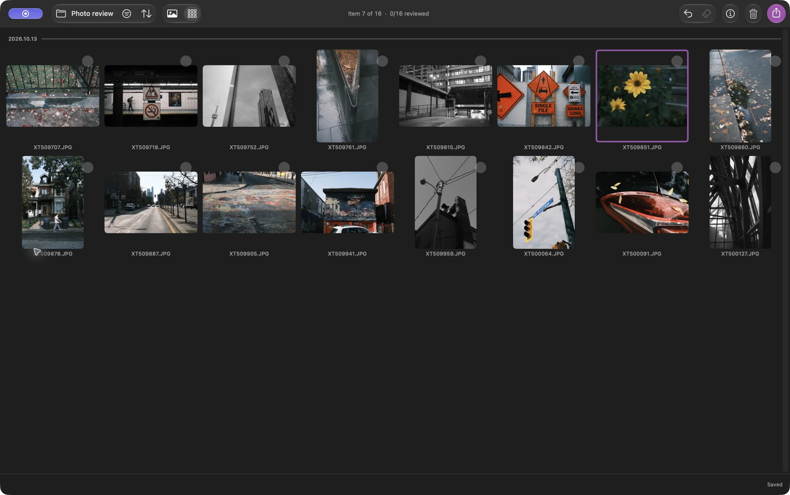

कभी-कभी मैं सैर की सबसे अच्छी फ़ोटो चुनकर उन्हें एक फ़ोल्डर में रखना चाहता हूँ। इसके लिए एडिटिंग, RAW प्रोसेसिंग, या फ़ोटो लाइब्रेरी में इम्पोर्ट करने की ज़रूरत नहीं है

Louppe में आप JPEG का फ़ोल्डर खोल सकते हैं, मनचाही फ़ोटो पर निशान लगा सकते हैं, और उन फ़ाइलों को अलग फ़ोल्डर में कॉपी कर सकते हैं। JPEG का मौजूदा रूप बना रहता है; कॉपी करने से वे फिर से एनकोड नहीं होतीं

Louppe फ़ोटो देखने और छाँटने का मेरा मुफ़्त, ओपन-सोर्स ऐप है, जो macOS 14 या बाद के संस्करण वाले Apple silicon Mac पर चलता है

## JPEG फ़ोटो के एक फ़ोल्डर से शुरू करें

शूट की फ़ोटो कैमरे के कार्ड से अपने Mac या बाहरी ड्राइव के एक फ़ोल्डर में कॉपी करें, और बैकअप अलग रखें। वह फ़ोल्डर Louppe में खोलें

यह गाइड Finder में रखी साधारण `.jpg` या `.jpeg` फ़ाइलों से शुरू होती है। Apple Photos में रखी फ़ोटो के लिए इसके बजाय **फ़ाइल → Apple Photos खोलें…** चुनें और लाइब्रेरी की समीक्षा वहीं करें। लाइब्रेरी की अंदरूनी फ़ाइलों को न छेड़ें

*ग्रिड में सिर्फ़ JPEG वाला फ़ोल्डर, Louppe 1.10 में लिया गया स्क्रीनशॉट। बैंगनी किनारा मौजूदा फ़ोटो बताता है; इसका मतलब यह नहीं कि उसे रखने के लिए चुना गया है*

यहाँ “फ़ोटो छाँटने” का मतलब है चुनना कि कौन-सी तस्वीरें रखनी हैं। फ़ाइल नाम या तारीख़ के हिसाब से उनका क्रम बदलना, क्रमबद्ध करें (Sort) में एक अलग विकल्प है

## हाँ और नहीं से रखने वाली फ़ोटो चुनें

गैलरी में एक फ़ोटो खोलें और शूट की एक-एक तस्वीर देखें। डिफ़ॉल्ट शॉर्टकट के साथ हाँ के लिए **F** और नहीं के लिए **D** दबाएँ। किसी तस्वीर को फिर देखने के लिए तीर वाली कुंजियाँ इस्तेमाल करें

जिन फ़ोटो को लेकर संदेह हो, उन्हें अनिर्णीत छोड़ दें और दूसरी बार समीक्षा करते समय उन पर लौटें। स्टार और रंग लेबल वैकल्पिक हैं; पूरे शूट की समीक्षा सिर्फ़ हाँ और नहीं से पूरी कर सकते हैं

**नहीं का निशान लगाने से कोई फ़ाइल कभी कूड़ेदान में नहीं जाती**। इससे एक फ़ैसला दर्ज होता है। सफ़ाई एक अलग कमांड है, जो फ़ाइलों को macOS के कूड़ेदान में भेजती है

Louppe खुले हुए फ़ोल्डर में `.louppe_session.json` में फ़ैसले सहेजता है। ड्राइव डिस्कनेक्ट करने से पहले सहेजने की स्थिति जाँचें और उसके पूरा होने का इंतज़ार करें। इस समीक्षा को बाद में जारी रखना हो तो वह फ़ाइल रखें

<!-- try-louppe -->

## कॉपी करने से पहले चुनी हुई फ़ोटो जाँचें

हाँ का फ़िल्टर लगाएँ और ग्रिड में रखने वाली फ़ोटो देखें। जाँचें कि क्या आपने कई लगभग एक जैसी तस्वीरें रख ली हैं, या कोई ऐसी फ़ोटो छोड़ दी है जिसे अब भी रखना चाहते हैं

पास से देखने के लिए गैलरी पर लौटें। डिफ़ॉल्ट कुंजियों के साथ **S** से असली 100% ज़ूम चालू या बंद होता है, जिससे फ़ोकस जाँचने में मदद मिलती है। बदले हुए शॉर्टकट अलग हो सकते हैं

## चुने हुए JPEG नए फ़ोल्डर में कॉपी करें

निर्यात खोलें और **कॉपी करें** चुनें। दायरा और मेल खाती फ़ाइलों की गिनती जाँचें: कुछ फ़ाइलें चुनी हुई हों तो निर्यात **सभी चयनित** से शुरू होता है; वरना यह फ़िल्टर से मिली **चुने हुए (हाँ) (Keepers (Yes))** से शुरू होता है। अगर रखने वाली फ़ोटो ही चाहिए, तो उनका दायरा ध्यान से चुनें

कोई नया गंतव्य चुनें, जैसे `October walk keepers`, काम पूरा होने का इंतज़ार करें, और Finder में गंतव्य खोलें। वहाँ की फ़ाइलें जाँचें और शेयर करने से पहले कॉपी किए गए कुछ JPEG खोलकर देखें

कॉपी करने से फ़ाइलें जस की तस रहती हैं, जिसमें उनका रिज़ॉल्यूशन और अंदर सहेजा मेटाडेटा भी शामिल है। इससे उनका आकार नहीं बदलता और स्थान की जानकारी भी नहीं हटती। अगर छोटी फ़ाइलें या मेटाडेटा हटाना चाहिए, तो ऐसे विकल्प देने वाले टूल में शेयर करने की कॉपियाँ तैयार करें

स्रोत फ़ोल्डर फिर से समीक्षा के लिए उपलब्ध रहता है। स्थानांतरित करें, नाम बदलें, स्रोत फ़ोल्डर व्यवस्थित करें, और सफ़ाई अलग-अलग कमांड हैं, जो फ़ाइलों की जगह या नाम बदलती हैं; इस तरीके के लिए इनमें से किसी की ज़रूरत नहीं है

## RAW एडिटर के बिना काम पूरा करें

अब आपके पास चुने हुए JPEG का एक साधारण फ़ोल्डर है। इसे किसी दूसरे फ़ोटो देखने वाले ऐप में खोलें, चुनी हुई फ़ाइलें भेजें, या अपने चयन के रूप में रखें। फ़ाइलें चुनने से उनका एक्सपोज़र या रंग नहीं बदलता

अगर आप RAW भी शूट करते हैं, तो [RAW + JPEG की जोड़ी बनाने की गाइड](/blog/cull-raw-jpeg-pairs-mac/) इस्तेमाल करें। अगर अगला चरण एडिटिंग है, तो [Lightroom से पहले फ़ोटो छाँटने का तरीका](/blog/cull-photos-mac-before-lightroom/) अपनाएँ
