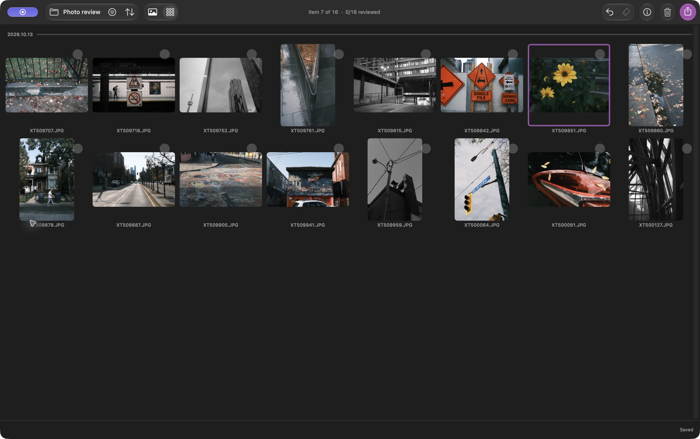

Às vezes quero escolher as melhores fotos de um passeio e colocá-las em uma pasta. Sem precisar de uma sessão de edição, processamento RAW, ou importação para uma biblioteca de fotos

No Louppe, você pode abrir uma pasta de JPEGs, marcar as fotos que quer, e copiar esses arquivos para uma pasta separada. Os JPEGs mantêm a aparência que já têm; a cópia não os recodifica

O Louppe é meu visualizador e organizador de fotos gratuito e de código aberto para Macs com Apple silicon e macOS 14 ou posterior

## Comece com uma pasta de fotos JPEG

Copie o ensaio do cartão da câmera para uma pasta no Mac ou em uma unidade externa e mantenha um backup separado. Abra essa pasta no Louppe

Este guia começa com arquivos `.jpg` ou `.jpeg` comuns no Finder. Para fotos no Fotos da Apple, escolha **Arquivo → Abrir Apple Photos…** e revise a biblioteca onde ela está. Não mexa nos arquivos internos da biblioteca

*Uma pasta só de JPEGs na Grade, capturada no Louppe 1.10. O contorno roxo identifica a foto atual; ele não marca uma foto como aprovada*

Aqui, “selecionar fotos” significa escolher quais imagens manter. Mudar a ordem por nome de arquivo ou data é uma escolha separada em Ordenar

## Escolha as fotos que quer manter com Sim e Não

Abra uma foto na Galeria e revise o ensaio uma imagem por vez. Com os atalhos padrão, pressione **F** para Sim e **D** para Não. Use as teclas de seta para voltar a uma imagem

Deixe sem decisão as fotos que gerarem dúvida e volte a elas em uma segunda revisão. Estrelas e etiquetas de cor são opcionais; você pode terminar um ensaio inteiro usando apenas Sim e Não

**Marcar Não nunca envia um arquivo para a Lixeira.** A marca registra uma decisão. Limpar é um comando separado que move arquivos para a Lixeira do macOS

O Louppe salva as decisões em `.louppe_session.json` na pasta aberta. Espere a confirmação de salvamento antes de desconectar uma unidade e mantenha esse arquivo se quiser retomar a revisão

<!-- try-louppe -->

## Confira a seleção antes de copiar

Filtre por Sim e confira as fotos escolhidas na Grade. Veja se manteve várias imagens quase idênticas ou deixou de fora alguma foto que ainda quer

Volte à Galeria para olhar de perto. Com as teclas padrão, **S** alterna o zoom real de 100%, o que ajuda a conferir o foco. Atalhos personalizados podem ser diferentes

## Copie os JPEGs escolhidos para uma nova pasta

Abra Exportar e escolha **Copiar**. Confira o escopo e a contagem de correspondências: com uma seleção ativa, Exportar começa com **Todos os selecionados**; sem ela, começa com **Aprovadas (Sim)** do filtro atual. Se é isso que você quer, escolha explicitamente o escopo das fotos marcadas Sim

Escolha um novo destino, como `October walk keepers`, espere a conclusão, e abra o destino no Finder. Confira os arquivos e abra alguns dos JPEGs copiados antes de compartilhá-los

Copiar preserva os arquivos, incluindo a resolução e os metadados incorporados. Não redimensiona as imagens nem remove informações de localização. Se precisar de arquivos menores ou sem metadados, prepare cópias para compartilhar em uma ferramenta que ofereça essas opções

A pasta de origem continua disponível para outra revisão. Mover, Renomear, Organizar, e Limpar alteram os locais ou os nomes dos arquivos por comandos separados; nenhum deles é necessário neste fluxo de trabalho

## Termine sem um editor RAW

Agora você tem uma pasta comum com os JPEGs escolhidos. Abra-a em outro visualizador, envie os arquivos selecionados, ou guarde-a como sua seleção. Selecionar arquivos não altera a exposição nem a cor das fotos

Se você também fotografa em RAW, use o [guia de agrupamento de RAW + JPEG](/blog/cull-raw-jpeg-pairs-mac/). Se o próximo passo é editar, siga o [fluxo de trabalho antes do Lightroom](/blog/cull-photos-mac-before-lightroom/)
