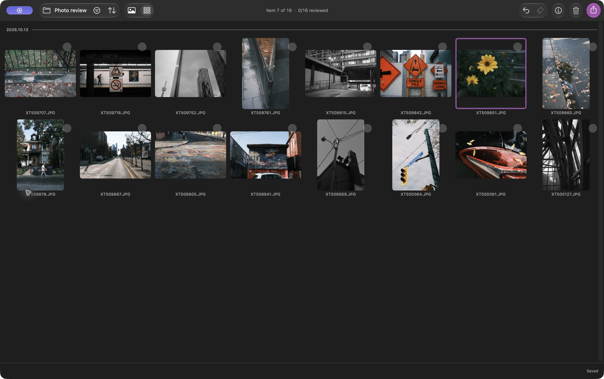

有时，我只想从散步时拍下的照片中挑出最好的一些，放进一个文件夹。不需要编辑、RAW 处理，也不需要导入照片图库

在 Louppe 中，你可以打开一个 JPEG 文件夹，标记想要的照片，再把这些文件复制到单独的文件夹。JPEG 会保留原有外观；复制不会对它们重新编码

Louppe 是我开发的一款免费、开源的照片查看与筛选工具，适用于运行 macOS 14 或更高版本的 Apple 芯片 Mac

## 从一个 JPEG 照片文件夹开始

把本次拍摄的照片从相机存储卡复制到 Mac 或外置驱动器上的文件夹中，并在别处保留备份。在 Louppe 中打开这个文件夹

本指南从 Finder 中普通的 `.jpg` 或 `.jpeg` 文件开始。如果照片在 Apple 照片中，请改用**文件 → 打开 Apple Photos…**，直接查看图库。不要改动图库内部的文件

*网格中的纯 JPEG 文件夹，截自 Louppe 1.10。紫色边框表示当前照片，不代表它已入选*

这里的“筛选照片”指的是选择要保留的照片。按文件名或日期调整排列顺序，是“排序”中的另一项选择

## 用“是”和“否”选择入选照片

在图库中打开一张照片，逐张查看本次拍摄的照片。使用默认快捷键时，按 **F** 标记为“是”，按 **D** 标记为“否”。用方向键返回之前的照片

拿不准的照片先不做决定，留到第二轮再看。星级和颜色标签是可选的；只用“是”和“否”也能完成整次拍摄的筛选

**标记为“否”绝不会将文件移到废纸篓**。它只是记录一个决定。清理是单独的命令，会将文件移到 macOS 废纸篓

Louppe 将决定保存在所打开文件夹中的 `.louppe_session.json` 文件里。断开驱动器连接前，先等到状态显示保存完成；如果想继续这次筛选，请保留这个文件

<!-- try-louppe -->

## 复制前检查候选照片

筛选出标记为“是”的照片，在网格中查看入选照片。检查是否保留了好几张几乎相同的照片，或漏掉了仍想保留的照片

切回图库仔细查看。使用默认按键时，**S** 可切换到真正的 100% 缩放，帮助你检查对焦。自定义快捷键可能不同

## 将选好的 JPEG 复制到新文件夹

打开导出，选择**复制**。检查范围和匹配数量：当前有选中文件时，导出默认使用**全部选中**；没有选中文件时，默认使用当前筛选结果中的**保留（是）**。如果你想复制入选照片，请明确选择这个范围

选择一个新目标位置，例如 `October walk keepers`，等复制完成后，在 Finder 中打开目标位置。分享前，先检查里面的文件，并打开几张复制后的 JPEG 看看

复制会保留文件，包括分辨率和内嵌元数据。它不会缩小照片，也不会移除位置信息。如果需要较小的文件或去除元数据，请使用提供这些选项的工具制作分享用的副本

源文件夹仍可用于下一轮筛选。移动、重命名、整理源文件夹和清理会通过各自的命令改变文件位置或名称；这套流程不需要使用它们

## 无需 RAW 编辑软件即可完成

现在，你有了一个普通文件夹，里面都是选好的 JPEG。可以用其他照片查看工具打开它，发送选定文件，或把它留作候选照片文件夹。选择文件不会改变照片的曝光或颜色

如果你也拍 RAW，可以使用 [RAW + JPEG 配对指南](/blog/cull-raw-jpeg-pairs-mac/)。如果下一步要编辑照片，可以按照[在 Lightroom 前筛片的流程](/blog/cull-photos-mac-before-lightroom/)继续
