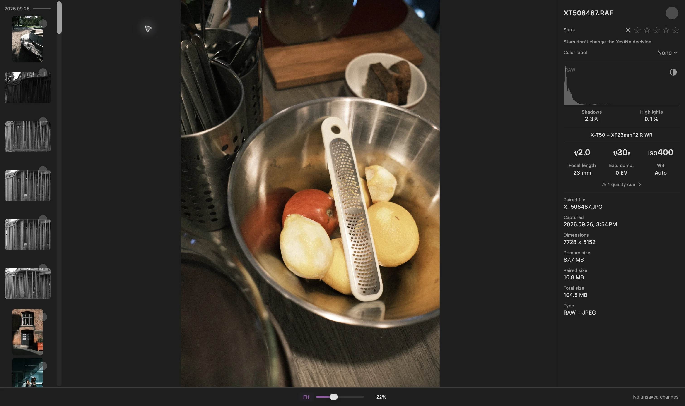

قد تبدو صورة RAW مثل صورة JPEG التي تنتجها كاميرتك في وضع الملاءمة (Fit)، ثم تتغيّر ألوانها، أو تباينها، أو تفاصيلها عند التكبير. في وضع العرض سريع (Fast) في Louppe، قد يحدث ذلك لأن التطبيق ينتقل من معاينة إلى صورة ناتجة عن معالجة RAW عند `100%`

لا يعني هذا الانتقال وحده أن الملف الأصلي قد تغيّر. أفصل بين سؤالين: أي معالجة أراها، وما الذي أحاول تقييمه؟

## قد تختلف معاينة الكاميرا عن معالجة RAW

تحتوي كثير من ملفات RAW من الكاميرات على معاينة مُعالَجة. وقد تعكس اختيارات الكاميرا للألوان، والتباين، وزيادة الحدّة. قد تنتج معالجة بيانات RAW بأداة أخرى مظهرًا مختلفًا

[تشرح Adobe الفرق نفسه](https://helpx.adobe.com/lightroom-classic/desktop/technical-support/technical-issues/miscellaneous-issues/color-faq.html) في Lightroom Classic: قد تختلف معاينة الكاميرا المضمّنة عن الصورة المعالجة التي ينشئها Lightroom

إذا أعجبك المظهر النهائي لصورة JPEG من الكاميرا، فراجع ملف JPEG مباشرة. ليس على أداة معالجة RAW أن تعيد إنتاج مظهر الكاميرا

## ما الذي يتغيّر عند `100%` في Louppe؟

في [Louppe 1.13](https://github.com/murlexander/louppe-media-culler/releases/tag/v1.13.0)، يستخدم وضع **سريع (Fast)** معاينات عند نسب تكبير أقل من `100%`، ومعالجة Apple لملفات RAW عند `100%` وما فوق. تواصل الشبكة والمتصفح استخدام معاينات سريعة

باستخدام المفاتيح الافتراضية، يتيح **`S`** تفعيل العرض الحقيقي بنسبة `100%` أو إيقافه في المعرض. إذا تغيّرت الصورة عند تجاوز هذه العتبة، فتحقّق من **الإعدادات ← عام ← عرض RAW (`Settings → General → RAW display`)**. يمكنك اختيار **RAW في جميع مستويات التكبير (RAW at all zoom levels)** ليبقى مصدر معالجة الصورة في المعرض ثابتًا

Louppe تطبيق مجاني ومفتوح المصدر أُطوّره لعرض الصور وفرزها، ويعمل على أجهزة Mac المزودة بشرائح Apple silicon بنظام macOS 14 أو أحدث. يعتمد دعم الكاميرا على ملف RAW ومُفكّك الترميز المتاح

<!-- try-louppe -->

## تسمية المدرج التكراري تجيب عن سؤال آخر

*فحص RAW + JPEG، التُقط في Louppe 1.9. تحدّد تسمية RAW في المدرج التكراري مصدر التحليل؛ ولا تحدّد مصدر معالجة الصورة المعروضة*

لملف RAW، قد تتغيّر تسمية المدرج التكراري من **معاينة (Preview)** إلى **RAW** بعد اكتمال تحليل منفصل. يحدث هذا بصورة مستقلة عن معالجة الصورة المعروضة. أما تراكب فقدان التفاصيل **`X`** فيقيس الصورة المعالجة المعروضة

استخدم المدرج التكراري والصورة، كلًّا لغرضه. وجود تسمية RAW على المدرج التكراري لا يثبت أن الصورة الكبيرة المعروضة ناتجة بالفعل عن معالجة Apple لملفات RAW

## حدّد ما تحتاج إلى مقارنته

- **التكوين والتعبير:** راجع اللقطة كاملة في وضع الملاءمة (Fit)
- **التركيز والتفاصيل الدقيقة:** افحص المنطقة المعنية بنسبة `100%`، بعد اكتمال المعالجة
- **ألوان الكاميرا النهائية:** افتح صورة JPEG من الكاميرا، إذا كنت قد سجّلت واحدة
- **التحرير الذي ستجريه لاحقًا:** افحص RAW في المحرّر وبملف التعريف الذي تنوي استخدامه

عند مقارنة تطبيقين، استخدم الملف الفعلي نفسه، ونسبة تكبير مماثلة، وإعدادات معالجة معروفة. المعاينة في تطبيق وصورة RAW مُعالَجة في تطبيق آخر تجيبان عن سؤالين مختلفين

## إذا تعذّرت معالجة RAW

انتظر اكتمال التحميل واقرأ رسالة الخطأ قبل رفض الصورة. **استخدام المعاينة (Use Preview)** خيار بديل تختاره صراحةً بعد فشل تحميل RAW

يتطلب مُفكّك الترميز الاختياري **RAW 9** نظام macOS 27، وملفًا مدعومًا، وموارد نماذج Apple، ويستهلك وقتًا وذاكرة أكثر. إذا فشل، يتيح Louppe **إعادة المحاولة (Retry)** أو **استخدام إعداد Apple الافتراضي (Use Apple Default)**. لا يبدّل مفكّك الترميز دون علمك

لا يؤدّي تغيير تفضيل العرض إلى تحرير ملفك الأصلي أو إعادة كتابته. لجلسة تصوير تضم التنسيقين، يشرح [دليل RAW + JPEG](/blog/cull-raw-jpeg-pairs-mac/) كيفية مراجعتهما معًا أو على حدة
