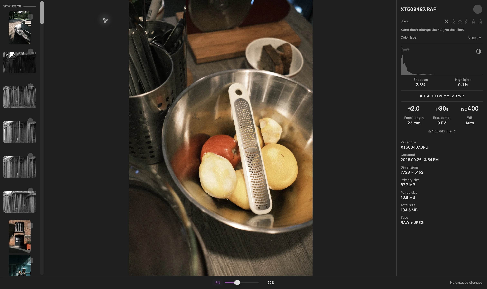

Una foto RAW puede parecerse al JPEG de la cámara en Ajustar y después cambiar de color, contraste, o detalle al ampliar. En el modo de visualización Rápido de Louppe, esto puede ocurrir porque la aplicación pasa de una vista previa a un revelado RAW al 100%

Esa transición por sí sola no significa que el archivo original haya cambiado. Me planteo dos preguntas por separado: ¿qué revelado estoy viendo? ¿Qué intento evaluar?

## Una vista previa de cámara y un revelado RAW pueden ser distintos

Muchos archivos RAW de cámara incluyen una vista previa procesada. Puede reflejar los ajustes de color, contraste, y nitidez de la cámara. Revelar los datos RAW con otro procesador puede producir un aspecto distinto

[Adobe explica la misma distinción](https://helpx.adobe.com/lightroom-classic/desktop/technical-support/technical-issues/miscellaneous-issues/color-faq.html) en Lightroom Classic: la vista previa incrustada de la cámara puede diferir del revelado que genera Lightroom

Si te gusta el aspecto terminado de un JPEG de cámara, revisa ese JPEG directamente. Un procesador RAW no tiene por qué reproducir el aspecto de la cámara

## ¿Qué cambia al 100% en Louppe?

En [Louppe 1.13](https://github.com/murlexander/louppe-media-culler/releases/tag/v1.13.0), **Rápido** usa vistas previas por debajo del 100% y el revelado RAW de Apple al 100% o más. Cuadrícula y Explorador siguen usando vistas previas rápidas

Con las teclas predeterminadas, **S** activa o desactiva el zoom real al 100% en Galería. Si la imagen cambia al cruzar ese umbral, comprueba **Ajustes → General → Visualización RAW**. Puedes elegir RAW en todos los niveles de zoom para que Galería mantenga una fuente de revelado constante

Louppe es mi visor y organizador de fotos gratuito y de código abierto para Mac con Apple silicon y macOS 14 o posterior. La compatibilidad con las cámaras depende del archivo RAW y del decodificador disponible

<!-- try-louppe -->

## La etiqueta del histograma responde a otra pregunta

*Inspección de RAW + JPEG capturada en Louppe 1.9. La etiqueta RAW del histograma identifica la fuente del análisis; no identifica el revelado de la foto que se muestra*

Para un archivo RAW, el histograma puede cambiar de **Vista previa** a **RAW** cuando termina un análisis independiente. Esto ocurre con independencia del revelado de la foto. La superposición de recorte tonal (**X**) mide el revelado mostrado

Usa el histograma y la imagen para sus respectivas tareas. Que el histograma lleve la etiqueta RAW no demuestra que la foto grande ya sea un revelado RAW de Apple

## Decide qué necesitas comparar

- **Composición y expresión:** revisa el encuadre completo en Ajustar
- **Enfoque y detalle fino:** examina la zona relevante al 100%, después de que termine el revelado
- **El color terminado de la cámara:** abre el JPEG de la cámara, si lo has guardado
- **Tu edición final:** comprueba el RAW en el editor y con el perfil que vayas a usar

Al comparar dos aplicaciones, usa el mismo archivo físico, un zoom comparable, y ajustes de revelado conocidos. Una vista previa en una aplicación y un RAW revelado en otra responden a preguntas distintas

## Si el RAW no se puede revelar

Espera a que termine la carga y lee el error antes de descartar la fotografía. **Usar vista previa** es una alternativa explícita si falla la carga de un RAW

El decodificador opcional **RAW 9** requiere macOS 27, un archivo compatible, y los recursos del modelo de Apple, y usa más tiempo y memoria. Si falla, Louppe ofrece Reintentar o **Usar Predeterminado de Apple**. No cambia de decodificador sin avisarte

Cambiar una preferencia de visualización no revela ni reescribe el archivo original. Para una sesión que contenga los dos formatos, la [guía de RAW + JPEG](/blog/cull-raw-jpeg-pairs-mac/) explica cómo revisarlos juntos o por separado
