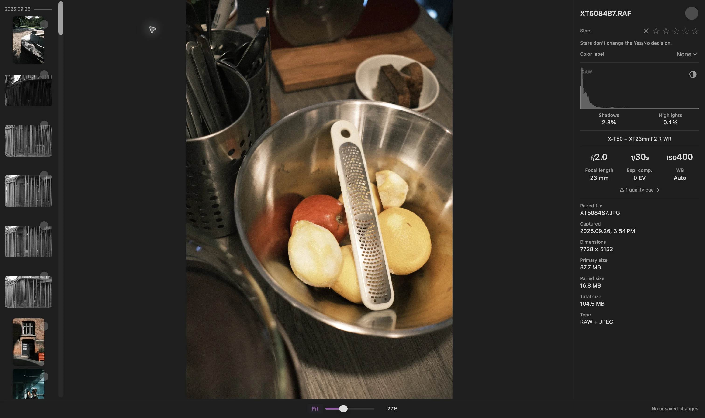

एक RAW फ़ोटो फिट पर कैमरे के JPEG जैसी दिख सकती है, फिर ज़ूम करने पर उसके रंग, कंट्रास्ट, या बारीकियों में बदलाव दिख सकता है। Louppe के तेज़ (Fast) डिस्प्ले मोड में ऐसा इसलिए हो सकता है क्योंकि ऐप 100% पर पूर्वावलोकन से RAW रेंडरिंग पर चला जाता है

सिर्फ़ इस बदलाव का मतलब यह नहीं कि मूल फ़ाइल बदल गई है। मैं दो सवाल अलग रखता हूँ: मुझे कौन-सी रेंडरिंग दिख रही है, और मैं क्या परखना चाहता हूँ?

## कैमरे का पूर्वावलोकन और RAW रेंडरिंग अलग हो सकते हैं

कई कैमरों की RAW फ़ाइलों में पहले से प्रोसेस किया हुआ पूर्वावलोकन होता है। उसमें कैमरे के चुने हुए रंग, कंट्रास्ट, और शार्पनिंग दिख सकते हैं। किसी दूसरे प्रोसेसर से RAW डेटा रेंडर करने पर तस्वीर अलग दिख सकती है

Lightroom Classic के लिए [Adobe भी यही फ़र्क समझाता है](https://helpx.adobe.com/lightroom-classic/desktop/technical-support/technical-issues/miscellaneous-issues/color-faq.html): फ़ाइल में सहेजा गया कैमरे का पूर्वावलोकन, Lightroom की बनाई रेंडरिंग से अलग हो सकता है

अगर आपको कैमरे के JPEG का तैयार रूप पसंद है, तो उसी JPEG की समीक्षा करें। ज़रूरी नहीं कि RAW प्रोसेसर कैमरे जैसा ही रूप बनाए

## Louppe में 100% पर क्या बदलता है?

[Louppe 1.13](https://github.com/murlexander/louppe-media-culler/releases/tag/v1.13.0) में **तेज़ (Fast)** मोड 100% से नीचे पूर्वावलोकन, और 100% या उससे ऊपर Apple RAW रेंडरिंग इस्तेमाल करता है। ग्रिड और ब्राउज़र में तेज़ पूर्वावलोकन ही रहते हैं

डिफ़ॉल्ट कुंजियों के साथ **S** से गैलरी में असली 100% ज़ूम चालू या बंद होता है। अगर उस सीमा को पार करते समय तस्वीर बदलती है, तो **सेटिंग्स → सामान्य → RAW प्रदर्शन** जाँचें। सभी ज़ूम स्तरों पर RAW रेंडरिंग चुन सकते हैं, ताकि गैलरी में रेंडरिंग का स्रोत एक ही बना रहे

Louppe फ़ोटो देखने और छाँटने का मेरा मुफ़्त, ओपन-सोर्स ऐप है, जो macOS 14 या बाद के संस्करण वाले Apple silicon Mac पर चलता है। कैमरे का समर्थन RAW फ़ाइल और उपलब्ध डिकोडर पर निर्भर करता है

<!-- try-louppe -->

## हिस्टोग्राम का लेबल एक अलग सवाल का जवाब देता है

*RAW + JPEG की जाँच, Louppe 1.9 में लिया गया स्क्रीनशॉट। हिस्टोग्राम का RAW लेबल विश्लेषण का स्रोत बताता है; यह नहीं बताता कि दिखाई जा रही फ़ोटो की रेंडरिंग कौन-सी है*

RAW फ़ाइल के लिए, अलग से चल रहा विश्लेषण पूरा होने पर हिस्टोग्राम का लेबल **पूर्वावलोकन (Preview)** से **RAW** में बदल सकता है। यह फ़ोटो की रेंडरिंग से स्वतंत्र है। **X** वाला क्लिपिंग ओवरले दिखाई जा रही रेंडरिंग को मापता है

हिस्टोग्राम और तस्वीर को उनके अपने काम के लिए इस्तेमाल करें। हिस्टोग्राम पर RAW लिखा होना यह साबित नहीं करता कि बड़ी फ़ोटो पहले से Apple RAW रेंडरिंग है

## तय करें कि आपको किस चीज़ की तुलना करनी है

- **कंपोज़िशन और भाव:** फिट पर पूरी तस्वीर देखें
- **फ़ोकस और बारीक विवरण:** रेंडरिंग पूरी होने के बाद ज़रूरी हिस्सा 100% पर जाँचें
- **कैमरे की तैयार तस्वीर के रंग:** अगर आपने कैमरे का JPEG भी बनाया था, तो उसे खोलें
- **आपकी अंतिम एडिटिंग:** RAW को उसी एडिटर और प्रोफ़ाइल में जाँचें जिसे आप इस्तेमाल करने वाले हैं

दो ऐप की तुलना करते समय डिस्क पर मौजूद एक ही फ़ाइल, तुलनीय ज़ूम, और ऐसी रेंडरिंग सेटिंग इस्तेमाल करें जिन्हें आप जानते हों। एक ऐप में पूर्वावलोकन और दूसरे में प्रोसेस किया हुआ RAW अलग-अलग सवालों के जवाब देते हैं

## अगर RAW रेंडर न हो

फ़ोटो को ख़ारिज करने से पहले लोडिंग पूरी होने का इंतज़ार करें और त्रुटि पढ़ें। RAW लोड न हो पाने के बाद **पूर्वावलोकन का प्रयोग करें (Use Preview)** एक विकल्प है जिसे आप ख़ुद चुनते हैं

वैकल्पिक **RAW 9** डिकोडर के लिए macOS 27, समर्थित फ़ाइल, और Apple के मॉडल संसाधन चाहिए, और यह ज़्यादा समय व मेमोरी इस्तेमाल करता है। अगर यह विफल हो, तो Louppe फिर आज़माएँ या **Apple डिफ़ॉल्ट का उपयोग करें (Use Apple Default)** का विकल्प देता है। यह बिना बताए डिकोडर नहीं बदलता

डिस्प्ले की प्राथमिकता बदलने से आपकी मूल फ़ाइल की एडिटिंग नहीं होती और उसे दोबारा लिखा भी नहीं जाता। दोनों फ़ॉर्मैट वाले शूट के लिए [RAW + JPEG की गाइड](/blog/cull-raw-jpeg-pairs-mac/) बताती है कि उन्हें साथ या अलग-अलग कैसे देखें
