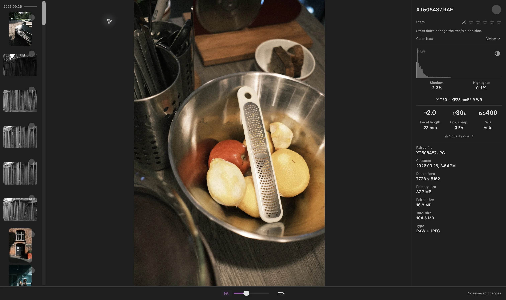

Uma foto RAW pode parecer igual ao JPEG da câmera em Ajustar e depois mudar de cor, contraste, ou detalhe quando você amplia a imagem. No modo de exibição Rápido (Fast) do Louppe, isso pode acontecer porque o app troca uma prévia por uma renderização RAW em 100%

Essa transição, por si só, não significa que o arquivo original mudou. Eu separo as duas perguntas: qual renderização estou vendo e o que quero avaliar?

## Uma prévia da câmera e uma renderização RAW podem ser diferentes

Muitos arquivos RAW de câmeras incluem uma prévia processada. Ela pode refletir as escolhas de cor, contraste, e nitidez da câmera. Renderizar os dados RAW com outro processador pode produzir uma aparência diferente

[A Adobe explica a mesma distinção](https://helpx.adobe.com/lightroom-classic/desktop/technical-support/technical-issues/miscellaneous-issues/color-faq.html) no Lightroom Classic: uma prévia incorporada da câmera pode diferir da renderização que o Lightroom gera

Se você gosta da aparência finalizada de um JPEG da câmera, revise esse JPEG diretamente. Um processador RAW não precisa reproduzir a aparência da câmera

## O que muda em 100% no Louppe?

No [Louppe 1.13](https://github.com/murlexander/louppe-media-culler/releases/tag/v1.13.0), **Rápido (Fast)** usa prévias abaixo de 100% e a renderização RAW da Apple em 100% ou mais. A Grade e o Navegador mantêm as prévias rápidas

Com as teclas padrão, **S** alterna o zoom real de 100% na Galeria. Se a imagem mudar ao cruzar esse limite, confira **Ajustes → Geral → Visualização RAW**. Você pode escolher a renderização RAW em todos os níveis de zoom para manter a Galeria com a mesma fonte de renderização

O Louppe é meu visualizador e organizador de fotos gratuito e de código aberto para Macs com Apple silicon e macOS 14 ou posterior. O suporte à câmera depende do arquivo RAW e do decodificador disponível

<!-- try-louppe -->

## O rótulo do histograma responde a outra pergunta

*Inspeção de RAW + JPEG, capturada no Louppe 1.9. O rótulo RAW do histograma identifica a fonte da análise; ele não identifica a renderização da foto exibida*

Para um arquivo RAW, o histograma pode mudar de **Prévia** para **RAW** depois que uma análise separada termina. Isso acontece independentemente da renderização da foto. A sobreposição de recorte tonal **X** mede a renderização exibida

Use o histograma e a imagem para suas respectivas funções. Um rótulo RAW no histograma não confirma que a foto grande já seja uma renderização RAW da Apple

## Decida o que você precisa comparar

- **Composição e expressão:** revise a imagem inteira em Ajustar
- **Foco e detalhes finos:** examine a área relevante em 100%, depois que a renderização terminar
- **A cor final da câmera:** abra o JPEG da câmera, se você tiver registrado um
- **Sua edição final:** confira o RAW no editor e com o perfil que pretende usar

Ao comparar dois apps, use o mesmo arquivo físico, um zoom comparável, e configurações de renderização conhecidas. Uma prévia em um app e um RAW revelado em outro respondem a perguntas diferentes

## Se o RAW não renderizar

Espere o carregamento terminar e leia o erro antes de rejeitar a fotografia. **Usar prévia** é uma alternativa explícita após uma falha no carregamento do RAW

O decodificador opcional **RAW 9** requer macOS 27, um arquivo compatível, e os recursos do modelo da Apple, e usa mais tempo e memória. Se ele falhar, o Louppe oferece Tentar novamente ou **Usar Padrão da Apple**. Ele não troca de decodificador silenciosamente

Mudar uma preferência de exibição não revela nem regrava o arquivo original. Para um ensaio com os dois formatos, o [guia de RAW + JPEG](/blog/cull-raw-jpeg-pairs-mac/) explica como revisá-los juntos ou separadamente
