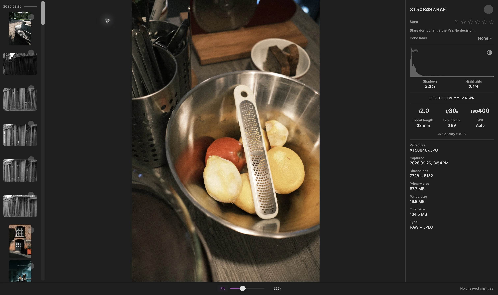

RAW 照片在适合窗口时可能看起来像相机 JPEG，放大后却出现颜色、对比度或细节变化。在 Louppe 的快速（Fast）显示模式中，这可能是因为应用在 100% 时从预览切换到了 RAW 渲染

这种切换本身并不意味着原始文件发生了变化。我会把这两个问题分开看：眼前是哪种渲染结果，以及我想判断什么？

## 相机预览与 RAW 渲染可能不同

许多相机 RAW 文件包含经过处理的预览图。它可能体现相机的色彩处理、对比度和锐化效果。用另一种处理引擎渲染 RAW 数据，可能得到不同的外观

[Adobe 也解释了这种区别](https://helpx.adobe.com/lightroom-classic/desktop/technical-support/technical-issues/miscellaneous-issues/color-faq.html)：在 Lightroom Classic 中，相机内嵌预览可能与 Lightroom 生成的渲染结果不同

如果你喜欢相机 JPEG 处理好的效果，就直接查看那个 JPEG。RAW 处理软件不一定会还原相机的效果

## Louppe 在 100% 时会发生什么变化？

在 [Louppe 1.13](https://github.com/murlexander/louppe-media-culler/releases/tag/v1.13.0) 中，**快速（Fast）**模式在低于 100% 时使用预览，在 100% 及以上时使用 Apple RAW 渲染。网格和浏览栏仍使用快速预览

使用默认按键时，**S** 可在图库中切换到真正的 100%。如果跨过这个缩放比例时图像发生变化，请检查**设置 → 通用 → RAW 显示**。你可以选择“所有缩放级别均使用 RAW”，让图库始终使用同一种渲染来源

Louppe 是我开发的一款免费、开源的照片查看与筛选工具，适用于运行 macOS 14 或更高版本的 Apple 芯片 Mac。相机支持情况取决于 RAW 文件和可用的解码器

<!-- try-louppe -->

## 直方图标签回答的是另一个问题

*RAW + JPEG 检查画面，截自 Louppe 1.9。直方图的 RAW 标签标识分析来源，并不表示当前显示的照片使用哪种渲染*

对于 RAW 文件，单独的分析完成后，直方图的标签可能从**预览（Preview）**变为 **RAW**。这与照片的渲染过程相互独立。**X** 剪切叠层测量的是当前显示的渲染结果

让直方图和图像各司其职。直方图显示 RAW 标签，并不能证明大图已使用 Apple RAW 渲染

## 决定你需要比较什么

- **构图和表情：**以适合窗口查看整个画面
- **对焦和精细细节：**渲染完成后，在 100% 下检查相关区域
- **相机处理好的色彩：**如果拍摄时保存了相机 JPEG，就打开它
- **最终的后期效果：**在你打算使用的编辑软件中，用计划采用的配置文件查看 RAW

比较两个应用时，使用同一个实际文件、相近的缩放比例，以及已知的渲染设置。一个应用中的预览和另一个应用中处理后的 RAW，回答的是不同的问题

## RAW 无法渲染时

等加载完成，阅读错误信息后，再决定是否舍弃这张照片。RAW 加载失败后，可以明确选择**使用预览（Use Preview）**作为备用方案

可选的 **RAW 9** 解码器需要 macOS 27、受支持的文件，以及 Apple 的模型资源，而且耗时更长、占用内存更多。如果失败，Louppe 会提供“重试”或**使用 Apple 默认（Use Apple Default）**。它不会悄悄切换解码器

更改显示偏好不会对原始文件进行后期处理或改写。如果本次拍摄包含两种格式，[RAW + JPEG 指南](/blog/cull-raw-jpeg-pairs-mac/)介绍了如何一起或分别筛选它们
